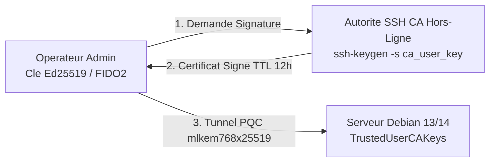

<!-- MASTER-HEADER-START -->
<div align="center">

<a href="https://0xcyberlitech.com/">
  
</a>

<p align="center">
  <a href="https://0xcyberlitech.com/"></a>
  <a href="https://0xcyberlitech.com/soc-rd.html"></a>
  <a href="https://0xcyberlitech.com/jarvis-rd.html"></a>
  <a href="https://github.com/0xCyberLiTech?tab=repositories"></a>
</p>
<p align="center">
  <a href="README.md"></a>
</p>


</div>
<!-- MASTER-HEADER-END -->

<!-- DEBIAN-TRUTH-START -->
> [!IMPORTANT]
>  ** Matrice Officielle Debian — `Debian 12 (Bookworm)` · `Debian 13 (Trixie)` · `Debian 14 (Forky)`**
> - **Sources Officielles Debian.org (`openssh`) :** `Bookworm (12)` : **`1:9.2p1-2+deb12u10`** &nbsp;·&nbsp; `Trixie (13 — Stable)` : **`1:10.0p1-7+deb13u4`** &nbsp;·&nbsp; `Forky (14 — Next-Gen)` : **`1:10.6p1-1`**
> - **Références Officielles :** [Paquet Debian Trixie (`openssh-server`)](https://packages.debian.org/trixie/openssh-server) &nbsp;·&nbsp; [Paquet Debian Forky (`openssh-server`)](https://packages.debian.org/forky/openssh-server) &nbsp;·&nbsp; [Documentation Officielle Debian](https://wiki.debian.org/SSH)
> - **Note d'Ingénierie (Divergence 13 vs 14) :** Sous Debian 13 (Trixie) et Debian 14 (Forky), l'unité systemd se nomme **`ssh.service`** (et non `sshd`), les surcharges se placent dans **`/etc/ssh/sshd_config.d/*.conf`**, et les logs d'authentification se lisent via `journalctl -u ssh` (`/var/log/auth.log` n'existe plus sans `rsyslog`).

<details>
<summary> <b>Afficher les Encarts Ligne de Commande : Debian 13 (Trixie — Stable) vs Debian 14 (Forky — Next-Gen)</b></summary>

####  Profil Production Stable — Commandes pour `Debian 13 (Trixie)`
```bash
# Debian 13 (Trixie — OpenSSH 9.9+) : Durcissement modulaire dans /etc/ssh/sshd_config.d/
sudo sshd -t && sudo systemctl reload ssh
sudo journalctl -u ssh.service -n 50 --no-hostname
```

####  Profil Anticipation Next-Gen — Commandes pour `Debian 14 (Forky)`
```bash
# Debian 14 (Forky — OpenSSH 10.x) : Suppression definitive du support DSA & echange post-quantique sntrup761/mlkem768
ssh -Q kex | grep -E 'mlkem|sntrup'
sudo sshd -T | grep -E 'permitrootlogin|passwordauthentication|port'
```

</details>
<!-- DEBIAN-TRUTH-END -->

<!-- CIEL-PEDAGOGY-START -->
<details>
<summary> <b>Synthèse d'Architecture, Standards Officiels &amp; Diagnostic (Niveau 1 : Fondamentaux · Niveau 2 : Repères · Niveau 3 : Diagnostic)</b></summary>

- **Niveau 1 — Fondamentaux &amp; Principe d'Architecture :** **OpenSSH (`sshd`)** fournit un canal d'administration distante, d'exécution de commandes et de transfert de fichiers (`SFTP`) intégralement chiffré et authentifié de bout en bout.
- **Niveau 2 — Repères Officiels (Ports IANA, Fichiers Debian &amp; Commandes de Validation) :** **Port IANA :** `TCP 22` (ou port durci dédié) &nbsp;|&nbsp; **Fichiers Debian :** `/etc/ssh/sshd_config`, `/etc/ssh/sshd_config.d/*.conf`, `~/.ssh/authorized_keys` (`chmod 600`) &nbsp;|&nbsp; **Validation officielle :** `sudo sshd -t`.
- **Niveau 3 — Diagnostic d'Incidents &amp; Ingénierie Avancée :** **Diagnostic & Architecture :** Si l'authentification par clé publique échoue, contrôlez les droits POSIX stricts (`chmod 700 ~/.ssh` et `chmod 600 ~/.ssh/authorized_keys`). Désactivez l'authentification par mot de passe (`PasswordAuthentication no`) au profit de clés asymétriques `Ed25519`, de certificats SSH (CA) et de l'échange de clés hybride post-quantique (`mlkem768x25519-sha256` dès OpenSSH 9.9/10.0).
- **Sources de Vérité Officielles Éditeurs &amp; Standards :** [Manpage Officielle OpenSSH sshd_config(5)](https://man.openbsd.org/sshd_config) &nbsp;·&nbsp; [Spécifications Officielles OpenSSH](https://www.openssh.com/specs.html) &nbsp;·&nbsp; [Recommandations ANSSI OpenSSH](https://cyber.gouv.fr/)

</details>
<!-- CIEL-PEDAGOGY-END -->


#  Durcissement OpenSSH 9.9/10.0 : Cryptographie Post-Quantique (ML-KEM), Autorité de Certification SSH & FIDO2 sur Debian 12, 13 & 14

> **Objectif Opérationnel :** Durcir l'administration distante **OpenSSH (`sshd`)** sous **Debian 12 (Bookworm)**, **Debian 13 (Trixie — Stable)** et **Debian 14 (Forky — Next-Gen)** en activant l'échange de clés hybride **Post-Quantique (`mlkem768x25519-sha256` / `sntrup761x25519-sha512`)**, les clés matérielles **FIDO2 (`ed25519-sk`)** et une **Autorité de Certification SSH interne (SSH CA)** éliminant la gestion manuelle des fichiers `authorized_keys`.

<div align="center">

| Niveau | Étape Technique | Accès Direct |
|:---:|:---|:---:|
| **Niveau 1** | Pourquoi passer à la cryptographie Post-Quantique et aux Certificats SSH ? | [](#principes-pqc-ssh-ca) |
| **Niveau 2** | Configuration cryptographique durcie (`/etc/ssh/sshd_config.d/99-hardening.conf`) | [](#configuration-sshd-post-quantique) |
| **Niveau 3** | Déploiement d'une Autorité de Certification SSH (SSH CA) & Certificats éphémères | [](#autorite-certification-ssh-ca) |
| **Niveau 3** | Génération de clés matérielles FIDO2 (`ed25519-sk`) & Audit `sshd -t` | [](#cles-materielles-fido2-audit) |

</div>

---

<a id="principes-pqc-ssh-ca"></a>
##  01 // Pourquoi passer à la cryptographie Post-Quantique et aux Certificats SSH ?


Face à la menace *« Store Now, Decrypt Later »* (collecte de flux chiffrés aujourd'hui pour les déchiffrer ultérieurement), **OpenSSH 9.9+ / 10.0** (inclus dans **Debian 13 Trixie** et **Debian 14 Forky**) intègre nativement l'algorithme hybride standardisé par le NIST **ML-KEM (FIPS 203)** combiné à **X25519** (`mlkem768x25519-sha256`).

En parallèle, l'utilisation d'une **Autorité de Certification SSH (SSH CA)** résout le problème de l'accumulation de clés publiques obsolètes dans `~/.ssh/authorized_keys` : le serveur fait confiance à la clé publique de la CA et n'accepte que des certificats utilisateurs signés pour une durée limitée (ex. `8h` ou `24h`).



---

<a id="configuration-sshd-post-quantique"></a>
##  02 // Configuration cryptographique durcie (/etc/ssh/sshd_config.d/99-hardening.conf)


Créez un fichier de configuration modulaire dans `/etc/ssh/sshd_config.d/99-hardening.conf` imposant les algorithmes d'échange post-quantiques, le chiffrement authentifié (AEAD) et la désactivation totale des mots de passe :

<!-- CODE-WINDOW-START -->
> [!CAUTION]
> 
>
> ```ini
> PermitRootLogin no
> PasswordAuthentication no
> KbdInteractiveAuthentication no
> PubkeyAuthentication yes
> AuthenticationMethods publickey
>
> KexAlgorithms mlkem768x25519-sha256,sntrup761x25519-sha512@openssh.com,curve25519-sha256
> Ciphers chacha20-poly1305@openssh.com,aes256-gcm@openssh.com
> MACs hmac-sha2-512-etm@openssh.com,hmac-sha2-256-etm@openssh.com
> HostKeyAlgorithms ssh-ed25519,ssh-ed25519-cert-v01@openssh.com
>
> MaxAuthTries 3
> LoginGraceTime 20
> ClientAliveInterval 300
> ClientAliveCountMax 2
> X11Forwarding no
> AllowTcpForwarding no
> ```
<!-- CODE-WINDOW-END -->

---

<a id="autorite-certification-ssh-ca"></a>
##  03 // Déploiement d'une Autorité de Certification SSH (SSH CA) & Certificats éphémères


Sur votre poste d'administration sécurisé (ou coffre d'autorité), générez la clé maîtresse de l'Autorité de Certification Utilisateurs :

<!-- CODE-WINDOW-START -->
> [!CAUTION]
> 
>
> ```bash
> ssh-keygen -t ed25519 -f ~/.ssh/ca_users_cyberlitech -C "SSH-CA-Users-0xCyberLiTech"
> ```
<!-- CODE-WINDOW-END -->

Signez la clé publique d'un administrateur (`id_ed25519.pub`) pour une validité stricte de **12 heures** (`-V +12h`) sur le principal `sysadmin` :

<!-- CODE-WINDOW-START -->
> [!CAUTION]
> 
>
> ```bash
> ssh-keygen -s ~/.ssh/ca_users_cyberlitech -I "cert-marc-admin" -n sysadmin -V +12h ~/.ssh/id_ed25519.pub
> ssh-keygen -L -f ~/.ssh/id_ed25519-cert.pub
> ```
<!-- CODE-WINDOW-END -->

Sur chaque serveur Debian cible, copiez uniquement la clé publique `ca_users_cyberlitech.pub` dans `/etc/ssh/ca_users.pub` et déclarez-la dans `/etc/ssh/sshd_config.d/99-hardening.conf` :

<!-- CODE-WINDOW-START -->
> [!CAUTION]
> 
>
> ```ini
> TrustedUserCAKeys /etc/ssh/ca_users.pub
> ```
<!-- CODE-WINDOW-END -->

---

<a id="cles-materielles-fido2-audit"></a>
##  04 // Génération de clés matérielles FIDO2 (ed25519-sk) & Audit sshd -t


Si vous disposez d'une clé de sécurité matérielle **FIDO2 / WebAuthn** (YubiKey, Nitrokey, Token2), installez le paquet `libfido2-1` et générez une clé privée liée matériellement avec exigence de présence physique (`-O verify-required`) :

<!-- CODE-WINDOW-START -->
> [!CAUTION]
> 
>
> ```bash
> sudo apt update && sudo apt install -y libfido2-1
> ssh-keygen -t ed25519-sk -O resident -O verify-required -C "fido2-hardware-key"
> ```
<!-- CODE-WINDOW-END -->

Validez systématiquement la syntaxe du démon `sshd` avant d'appliquer le rechargement et vérifiez l'algorithme post-quantique négocié avec `ssh -vv` :

<!-- CODE-WINDOW-START -->
> [!CAUTION]
> 
>
> ```bash
> sudo sshd -t
> sudo systemctl reload ssh
> ssh -Q kex | grep -E "mlkem|sntrup"
> ```
<!-- CODE-WINDOW-END -->

<!-- MASTER-FOOTER-START -->
<div align="center">


<a href="https://0xcyberlitech.com/">
  
</a>

<p align="center"><a href="https://0xcyberlitech.com/"></a></p>

<sub><b>Architecturé &amp; Forgé par Marc &amp; Antigravity (Google DeepMind)</b> &nbsp;·&nbsp; <a href="https://0xcyberlitech.com/"><b>0xcyberlitech.com</b></a> &nbsp;·&nbsp; <a href="https://0xcyberlitech.com/soc-rd.html">Architecture SOC Cockpit v5.5</a> &nbsp;·&nbsp; <a href="https://0xcyberlitech.com/jarvis-rd.html">Architecture JARVIS Mark-VII</a> &nbsp;·&nbsp; <a href="https://0xcyberlitech.com/blueprint-jarvis.html">Blueprint Matériel RTX 5080</a></sub>

</div>
<!-- MASTER-FOOTER-END -->
